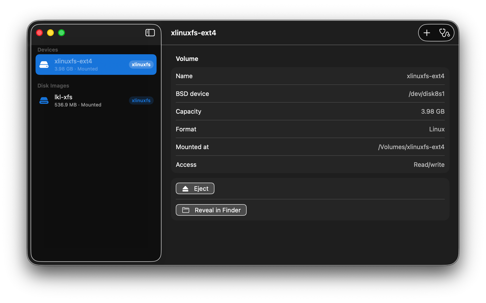

# xlinuxfs - Open-source Linux filesystem read/write for macOS

> Read and write ext2/3/4, XFS, and Btrfs drives on your Mac with Apple FSKit and the real Linux kernel via LKL, without macFUSE or a kernel extension.

> [Simplified Chinese](README_CN.md)

## What is xlinuxfs?

xlinuxfs is a macOS utility and **FSKit file-system extension** for Linux-formatted
external drives, SSDs, USB devices, partitions, and disk images. It brings
**ext2, ext3, ext4, XFS, and Btrfs** volumes to Finder and other Mac
applications under `/Volumes`, with read/write access when the media and mount
mode allow it.

macOS does not provide built-in Finder mounting for these Linux filesystems.
xlinuxfs supplies the missing filesystem layer while keeping the normal macOS
volume workflow: connect a drive, mount it, open it in Finder, work with files,
and eject it when finished.

## Why use xlinuxfs?

- **One Linux filesystem app for Mac** - work with ext2/3/4, XFS, and Btrfs from one focused utility.
- **Real Linux filesystem implementations** - the extension uses the Linux kernel drivers through LKL (Linux Kernel Library) instead of reimplementing each on-disk format.
- **Modern macOS integration** - uses Apple's FSKit model and mounts volumes through macOS, without macFUSE or a kernel extension.
- **Read/write or read-only control** - choose the access mode for supported devices and disk images; read-only media remains read-only.
- **Physical drives and disk images** - handle Linux USB drives, external disks, SSDs, partitions, and supported raw images.
- **Finder-compatible volumes** - mounted volumes appear under `/Volumes` and can be used by normal Mac applications.
- **Clear status and diagnostics** - inspect the filesystem, mount path, access mode, extension state, and common setup issues.
- **Apple Silicon and Intel** - universal builds support `arm64` and `x86_64`, with macOS 15.4 or later.
- **Open source and local** - source, tests, compatibility notes, and privacy policy are available in this repository; normal operation does not upload your files.

## Who is it for?

xlinuxfs is for Mac users who move Linux-formatted drives between Linux and
macOS, inspect ext4/XFS/Btrfs media from a server, NAS, Raspberry Pi, or
Steam Deck, access Linux partitions from a dual-boot machine, or open a Linux
disk image without starting a full Linux desktop.

If you are searching for an **ext4 driver for Mac**, **mount ext4 on macOS**,
**read and write Linux drives on a Mac**, **XFS for Mac**, **Btrfs for Mac**, a
**Linux filesystem driver for macOS**, an **open-source macOS disk utility**,
or a **macFUSE alternative**, xlinuxfs is built for that use case.

## Typical workflow

1. Install xlinuxfs and enable its file-system extension in **System Settings > General > Login Items & Extensions > File System Extensions**.
2. Connect a Linux-formatted drive or open the app to inspect a supported disk image.
3. Let macOS mount supported devices automatically, or choose the available mount action and access mode in xlinuxfs.
4. Open the mounted volume in Finder, use it with normal Mac applications, and eject it from the app or Finder when finished.

For disk images, macOS 27 supports the in-app raw-image workflow. Earlier
supported systems show a copyable Terminal command for image attachment when
the sandbox cannot perform that operation directly.

## macOS support

| macOS | Mounting workflow |
|---|---|
| macOS 15.4+ | Enable the extension, use normal Disk Arbitration auto-mount for Linux devices, and use the displayed Terminal command for disk-image attachment. |
| macOS 26 | Supported devices use the normal auto-mount workflow; disk images use the displayed Terminal attachment command. |
| macOS 27+ | Adds in-app raw image mounting and explicit device mounting with read-only/read-write selection. |

The exact workflow depends on the macOS version, extension state, device type,
partition layout, and whether the underlying media is writable.

## Supported filesystems and limits

| Filesystem | Access |
|---|---|
| ext2, ext3, ext4 | Read/write when mounted writable; read-only mode is also supported |
| XFS | Read/write when mounted writable; read-only mode is also supported |
| Btrfs | Read/write when mounted writable; read-only mode is also supported |

- The FSKit extension must be signed, installed, and enabled before macOS can use it.
- A physical medium or disk image attached read-only remains read-only; the driver cannot make read-only media writable.
- Direct in-app image mounting targets supported raw, single-volume images. Partitioned or compressed images use the Terminal attachment flow.
- xlinuxfs is a filesystem access utility, not a general file manager, partition editor, formatter, filesystem repair suite, or data-recovery tool.
- Check/repair is intentionally not presented as a destructive or recovery operation. Use the appropriate Linux filesystem tools and a backup for repair work.

## xlinuxfs and commercial alternatives

Users comparing Linux filesystem software for Mac may also come across
commercial products such as [extFS for Mac by Paragon Software](https://www.paragon-software.com/home/extfs-mac/),
which focuses on ext2/3/4 volumes, and [vmount](https://vmount.app/), which
uses a Linux microVM to expose supported Linux drives on macOS. xlinuxfs takes
a different approach: it is an open-source GPLv2 project built around Apple's
FSKit and the Linux kernel through LKL. It is independent and is not affiliated
with or endorsed by Apple, Linux, Paragon Software, vmount, or the Linux kernel
maintainers.

## Related projects

- [xntfs](https://github.com/HuanchuanTech/xntfs) provides open-source FSKit-based read/write support for NTFS volumes on macOS.
- [lkl](https://github.com/HuanchuanTech/lkl) contains the Linux Kernel Library source and Darwin build integration used by this project.

## Documentation

- [Architecture and code structure](docs/architecture.md)
- [Build and development](docs/build.md)
- [Platform support and verification](docs/platform-support.md)
- [Filesystem capabilities and limits](docs/filesystem-capabilities.md)
- [Privacy policy](PRIVACY.md)

## Open source

- [Source code and issues](https://github.com/HuanchuanTech/xlinuxfs)
- [GPLv2 license](LICENSE)

ext2, ext3, ext4, XFS, Btrfs, Linux, macOS, Apple, FSKit, LKL, macFUSE,
Paragon, and vmount are names or trademarks of their respective owners.
