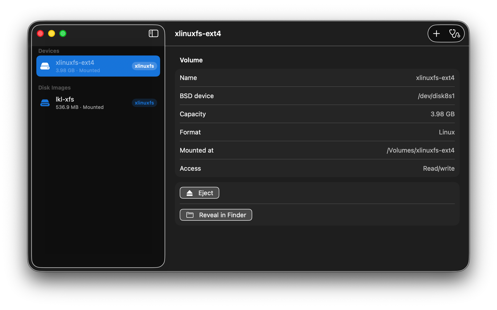

# xlinuxfs - macOS 上开源的 Linux 文件系统读写工具

> 在 Mac 上读写 ext2/3/4、XFS 和 Btrfs 磁盘。使用 Apple FSKit 和通过 LKL 运行的真实 Linux 内核，不需要 macFUSE，也不需要内核扩展。

> [English](README.md)

## 什么是 xlinuxfs？

xlinuxfs 是一个 macOS 工具和 **FSKit 文件系统扩展**，用于访问 Linux
格式的外置硬盘、SSD、U 盘、分区和磁盘映像。它支持
**ext2、ext3、ext4、XFS 和 Btrfs**，让这些卷以 `/Volumes` 下的普通 macOS
卷出现在 Finder 和其他 Mac 应用中；当介质和挂载模式允许时，支持读写。

macOS 本身不会在 Finder 中直接挂载这些 Linux 文件系统。xlinuxfs 补上这
一层文件系统支持，同时保留熟悉的 macOS 使用方式：连接磁盘、挂载卷、在
Finder 中操作文件，完成后推出磁盘。

## 为什么选择 xlinuxfs？

- **一个工具覆盖多种 Linux 文件系统** - 在 Mac 上统一使用 ext2/3/4、XFS 和 Btrfs。
- **使用真实的 Linux 文件系统实现** - 通过 LKL（Linux Kernel Library）使用 Linux 内核驱动，而不是重新实现每一种磁盘格式。
- **现代 macOS 集成** - 使用 Apple FSKit 模型，通过 macOS 挂载卷，不依赖 macFUSE，也不安装内核扩展。
- **可选读写或只读模式** - 对支持的设备和磁盘映像选择访问模式；只读介质始终保持只读。
- **支持物理磁盘和磁盘映像** - 处理 Linux U 盘、外置硬盘、SSD、分区和支持的原始映像。
- **兼容 Finder 的卷** - 挂载后出现在 `/Volumes`，普通 Mac 应用可以直接使用。
- **状态和诊断清晰** - 查看文件系统、挂载路径、访问模式、扩展状态和常见配置问题。
- **支持 Apple Silicon 和 Intel** - 提供 `arm64` 和 `x86_64` 通用构建，最低支持 macOS 15.4。
- **开源且本地运行** - 源代码、测试、兼容性说明和隐私政策均在仓库中；正常使用不会上传文件。

## 适合谁？

xlinuxfs 适合需要在 Linux 和 macOS 之间交换 Linux 磁盘的 Mac 用户，
需要从 Mac 查看服务器、NAS、树莓派或 Steam Deck 上的 ext4/XFS/Btrfs
磁盘的开发者和系统管理员，需要访问双系统 Linux 分区的用户，以及希望
不用启动完整 Linux 桌面就打开 Linux 磁盘映像的用户。

如果你正在搜索 **Mac 上的 ext4 驱动**、**在 macOS 挂载 ext4**、**Mac
读写 Linux 磁盘**、**Mac 上的 XFS**、**Mac 上的 Btrfs**、**macOS Linux
文件系统驱动**、**开源 Mac 磁盘工具** 或 **macFUSE 替代方案**，xlinuxfs
就是面向这类场景的工具。

## 常见使用流程

1. 安装 xlinuxfs，并在 **系统设置 > 通用 > 登录项与扩展 > 文件系统扩展** 中启用扩展。
2. 插入 Linux 格式磁盘，或打开应用查看支持的磁盘映像。
3. 让 macOS 自动挂载支持的设备，或者在 xlinuxfs 中选择可用的挂载操作和访问模式。
4. 在 Finder 中打开挂载卷，使用普通 Mac 应用操作文件，完成后从应用或 Finder 推出。

磁盘映像在 macOS 27 上支持应用内原始映像挂载。在其他受支持的系统上，
当沙盒不能直接执行附加操作时，应用会显示可以复制到终端执行的命令。

## macOS 支持

| macOS | 挂载流程 |
|---|---|
| macOS 15.4+ | 启用扩展后，Linux 设备使用 macOS 正常的 Disk Arbitration 自动挂载；磁盘映像使用应用显示的终端命令附加。 |
| macOS 26 | 支持的设备使用正常自动挂载流程；磁盘映像使用应用显示的终端附加命令。 |
| macOS 27+ | 增加应用内原始映像挂载，以及可明确选择只读/读写模式的设备挂载。 |

具体流程取决于 macOS 版本、扩展状态、设备类型、分区布局以及底层介质
是否允许写入。

## 支持范围与限制

| 文件系统 | 访问方式 |
|---|---|
| ext2、ext3、ext4 | 可写挂载时支持读写，也支持只读模式 |
| XFS | 可写挂载时支持读写，也支持只读模式 |
| Btrfs | 可写挂载时支持读写，也支持只读模式 |

- FSKit 扩展必须完成签名、安装并启用，macOS 才能使用它。
- 以只读方式附加的物理介质或磁盘映像仍然是只读；驱动不能把只读介质变成可写。
- 应用内直接挂载面向支持的原始单卷映像；分区映像或压缩容器使用终端附加流程。
- xlinuxfs 是文件系统访问工具，不是通用文件管理器、分区工具、格式化工具、文件系统修复套件或数据恢复工具。
- 检查/修复不会被包装成破坏性或恢复操作；修复前请使用对应的 Linux 工具并准备备份。

## xlinuxfs 与商业替代方案

搜索 Mac 上 Linux 文件系统工具时，也可能看到商业产品，例如专注于
ext2/3/4 的 [Paragon extFS for Mac](https://www.paragon-software.com/home/extfs-mac/)，
以及通过 Linux microVM 将支持的 Linux 磁盘提供给 macOS 的
[vmount](https://vmount.app/)。xlinuxfs 采用不同的路线：它是基于 Apple
FSKit 和 LKL Linux 内核的 GPLv2 开源项目。xlinuxfs 独立运行，与 Apple、
Linux、Paragon Software、vmount 或 Linux 内核维护者没有从属或背书关系。

## 关联项目

- [xntfs](https://github.com/HuanchuanTech/xntfs)：在 macOS 上提供基于 FSKit 的开源 NTFS 读写支持。
- [lkl](https://github.com/HuanchuanTech/lkl)：本项目使用的 Linux Kernel Library 源码和 Darwin 构建集成。

## 文档

- [架构与代码结构](docs/architecture.md)
- [构建与开发](docs/build.md)
- [平台支持与验证](docs/platform-support.md)
- [文件系统能力与边界](docs/filesystem-capabilities.md)
- [隐私政策](PRIVACY_CN.md)

## 开源

- [源代码与 Issues](https://github.com/HuanchuanTech/xlinuxfs)
- [GPLv2 许可证](LICENSE)

ext2、ext3、ext4、XFS、Btrfs、Linux、macOS、Apple、FSKit、LKL、macFUSE、
Paragon 和 vmount 是其各自所有者的名称或商标。
